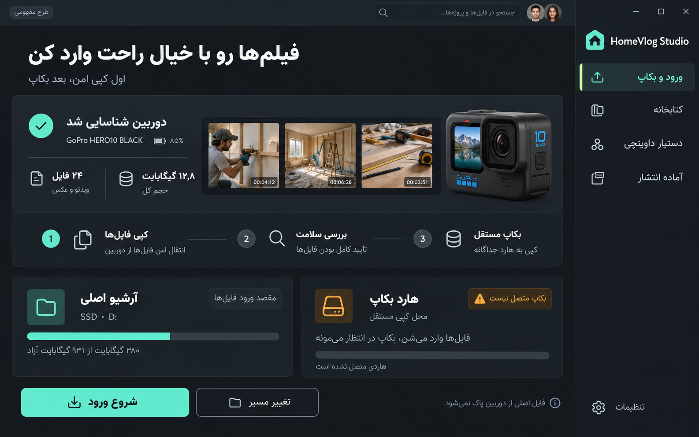
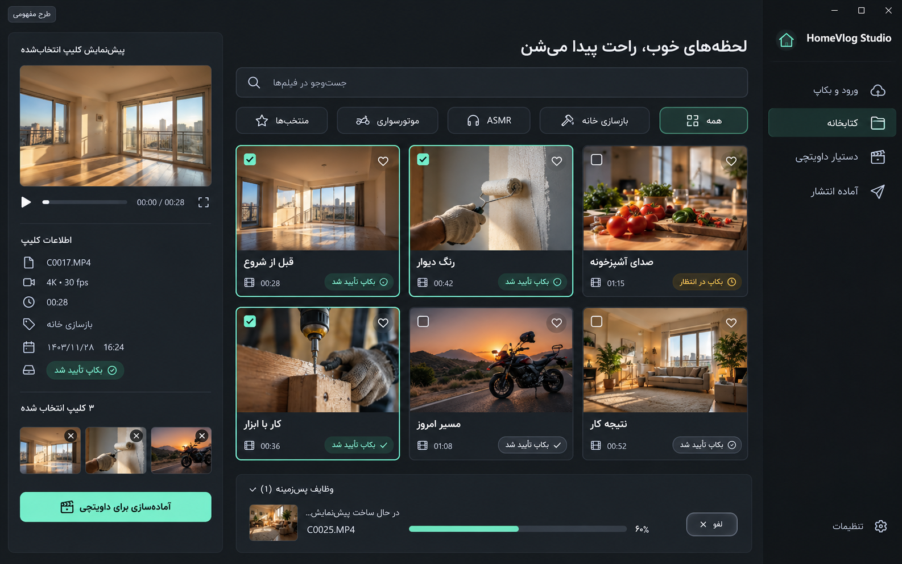
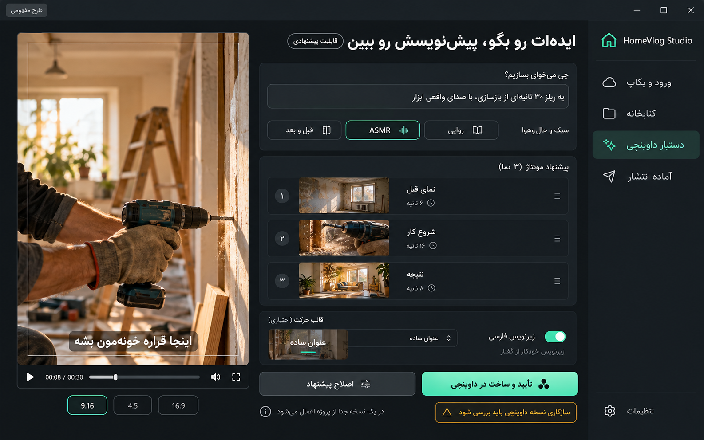

# Cutora | کاتورا

**از دوربین و هارد تا آرشیو مرتب و تدوین در DaVinci، با کمترین کار تکراری.**

Cutora یک برنامه دسکتاپ Windows با رابط فارسی، راست‌به‌چپ و مدرن است. هدف اصلی آن ورود امن فیلم‌ها، دسته‌بندی قابل اصلاح، بکاپ مستقل، مدیریت فضای SSD و هارد و آماده‌کردن رسانه برای تدوین است. نام قبلی طرح **HomeVlog Studio** بود؛ نام محصول از این مرحله **Cutora** است.

> وضعیت فعلی: بسته مستندات و موکاپ برای شروع توسعه. **هنوز برنامه، EXE یا قابلیت پیاده‌سازی‌شده در این ریپو وجود ندارد.**

## شروع روی کیس

ریپو را روی کیس clone و همان پوشه را به‌عنوان پروژه در Codex باز کنید. سپس این پیام را بدهید:

> فایل START.md را کامل بخوان و طبق پرامپت اجرایی داخل آن، توسعه Cutora را از بررسی همین سیستم شروع کن و تا آماده‌شدن نسخه شخصی قابل نصب و تست‌شده ادامه بده. پیشرفت و شواهد را در docs/implementation/STATUS.md ثبت کن. به خام‌ها دست نزن و محدودیت‌های ایمنی و هزینه را رعایت کن.

**[START.md: نقطه شروع Codex](START.md)**

## چیزی که باید برای کاربر آسان شود

- اتصال GoPro یا کارت، واردکردن فایل‌ها و دیدن وضعیت واقعی صحت و بکاپ.
- آوردن فیلم‌های قدیمی از هارد به کتابخانه، بدون کپی اجباری دوباره همه فایل‌ها.
- پیدا کردن فیلم با تاریخ، رویداد، موضوع، منتخب‌ها و بعداً متن گفت‌وگو.
- انتخاب «روی SSD آماده تدوین کن»، «روی هارد آرشیو کن»، «بکاپ بگیر» یا «از بکاپ برگردون» با preview مقصد و نتیجه روشن.
- شناخت اینکه فایل روی کدام دیسک است، آیا دیسک وصل است، کدام نسخه سالم بررسی شده و آیا فضای کافی داریم.
- تحویل کلیپ‌های منتخب به DaVinci؛ تدوین اصلی، موشن و خروجی در همان برنامه.
- گزینه آینده دستیار Codex در DaVinci با قابلیت‌های واقعاً آزمایش‌شده؛ هیچ قابلیت آزمایش‌نشده فعال یا کامل معرفی نشود.

سند الزام‌آور تجربه رسانه: **[MEDIA_WORKFLOWS.md](docs/specs/MEDIA_WORKFLOWS.md)**.

## معماری مبنا

Electron + React + TypeScript، هسته Node.js، SQLite، FFmpeg/FFprobe. پردازش سنگین خارج renderer؛ داده و رسانه محلی؛ cloud اختیاری و پیش‌فرض خاموش. نصب بدون نیاز به نصب Node یا Python روی دستگاه مقصد. انتخاب نسخه‌ها و packaging باید در Spike روی کیس اثبات شود.

## موکاپ‌های پیشنهادی

این تصاویر طرح مفهومی‌اند؛ اعداد و رسانه‌های داخلشان نمونه است. نام قدیمی روی تصاویر، نام نهایی محصول نیست. ظاهر و تجربه را مبنا بگیرید، متن و جزئیات ناهماهنگ را اصلاح کنید.

| ورود و بکاپ | کتابخانه | دستیار DaVinci |
|---|---|---|
|  |  |  |

[راهنمای طراحی و تصاویر کامل](docs/design/mockups/README.md)

## نقشه مستندات

| مسیر | نقش |
|---|---|
| [START.md](START.md) | پرامپت اجرایی، ترتیب مطالعه و تعریف پایان |
| [AGENTS.md](AGENTS.md) | قواعد ثابت کار Codex در ریپو |
| [تصمیمات فعلی](docs/decisions/USER_DECISIONS.md) | رفع تعارض با Gateهای قدیمی، اولویت‌ها و محدودیت مجوز |
| [گردش‌کار رسانه](docs/specs/MEDIA_WORKFLOWS.md) | قرارداد ورود، دسته‌بندی، آرشیو، انتقال دوطرفه، بکاپ و بازیابی |
| [برنامه اجرا](docs/implementation/PLAN.md) | milestoneها و معیار عبور |
| [وضعیت اجرا](docs/implementation/STATUS.md) | تحویل بین نشست‌ها؛ اکنون همه قابلیت‌ها شروع‌نشده‌اند |
| [گزارش‌های بررسی](docs/planning/README.md) | نقد محصول، معماری، MVP، هزینه، ریسک، AI، نشر و منابع |
| [مأموریت اولیه](docs/reference/ORIGINAL_BRIEF.md) | سابقه نیازمندی؛ محدودیت توقف قدیمی در تصمیمات جدید تعیین تکلیف شده |

## فایل‌هایی که عمداً در ریپو نیستند

فیلم‌های خانوادگی، فایل‌های دوربین، manifest واقعی رسانه، دیتابیس شخصی، API key، تنظیمات کاربر، مدل AI و binaryهای چندگیگابایتی. آن‌ها نباید همراه کد به GitHub فرستاده شوند. نمونه‌های تست آینده باید مصنوعی یا صریحاً مجاز باشند.

این ریپو محل توسعه است؛ محل آرشیو فیلم‌ها نیست. فعال‌کردن cloud، انتشار عمومی، خرید license و حذف اصل‌ها مجوز مستقل خود را می‌خواهند.
