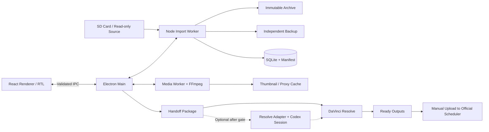

> **سابقه بررسی اولیه، نه وضعیت اجرای فعلی.** نام فعلی محصول Cutora است. برای ادامه و رفع تعارض با Gateهای قدیمی، [START](../../START.md)، [تصمیمات جاری](../decisions/USER_DECISIONS.md) و [گردش‌کار رسانه](../specs/MEDIA_WORKFLOWS.md) مقدم‌اند.

# معماری پیشنهادی و ADRها

وضعیت همه تصمیم‌ها: پیشنهاد، در انتظار تأیید. آخرین اولویت کاربر: زمان ساخت کم، رابط بسیار زیبا و پرموشن، نصب آسان، توسعه‌پذیری و ارتباط با برنامه‌های دیگر.

## ابتدا صفحات، سپس فناوری

سه فضای اصلی کافی است: «ورود و بکاپ»، «کتابخانه»، «تحویل به داوینچی / آماده انتشار». تنظیمات و صف کارها پنل جانبی‌اند. صفحه تدوین، نمودار تحلیلی، تقویم داخلی و timeline در P0 وجود ندارند. RESOLVE_ASSISTANT یک پنل اختیاری در فضای تحویل خواهد بود؛ صفحه تازه برای هر گام نسازیم.

## انتخاب واحد

**Electron + React + TypeScript، هسته Node.js، SQLite، FFmpeg/FFprobe و electron-builder/NSIS.** رابط محلی، بدون سرور HTTP، بدون Microservice، بدون Python اجباری. DaVinci یک برنامه خارجی مستقل است. مدل‌های ASR و adapterهای AI افزونه اختیاری مرحله بعد هستند.

## مقایسه گزینه‌ها

امتیازها قضاوت طراحی بر مبنای اولویت فعلی‌اند؛ نتیجه تست، سنجش عملکرد یا ارزیابی مهارت توسعه‌دهنده نیستند. ۱ ضعیف، ۵ قوی. اختلاف کم، قطعیت ایجاد نمی‌کند.

| معیار و وزن | Electron/React | Tauri/React | PySide6 | Flutter |
|---|---|---|---|---|
| سرعت توسعه ۲۰٪ | ۵؛ یک زبان برای UI و هسته | ۳؛ پل Rust و sidecar | ۴؛ Python ساده | ۳؛ Dart و پل رسانه |
| کارایی کار با Codex، ۱۰٪ | ۵؛ قراردادهای TS مشترک | ۴؛ دو محیط اجرایی | ۴؛ ساده ولی UI متفاوت | ۳؛ مهارت کاربر معلوم نیست |
| ظاهر و موشن، ۲۰٪ | ۵؛ اکوسیستم وب | ۵؛ همان UI وب | ۳؛ برای همین سطح جلوه، طراحی بیشتر | ۵؛ کنترل رسم قوی |
| بیلد و نصب، ۱۵٪ | ۴؛ runtime همراه، native DB آزمون‌پذیر | ۳؛ Rust/WebView2 و sidecar | ۴؛ بسته Python و Qt | ۴؛ build ویندوز و pluginها |
| پخش و Windows/integration، ۱۰٪ | ۴؛ Node و FFmpeg؛ HEVC از proxy | ۳؛ webview و پل بومی | ۴؛ Qt Multimedia و COM | ۲؛ پخش Windows به plugin دیگر نیاز دارد |
| عملکرد و حافظه، ۱۰٪ | ۲؛ runtime حجیم‌تر | ۵؛ پوسته سبک‌تر، backend جدا | ۴؛ وابسته به widgets/media | ۴؛ GPU و engine خودش |
| نگهداری و توسعه‌پذیری، ۱۰٪ | ۴؛ TS مشترک؛ update امنیتی لازم | ۴؛ قرارداد Rust/TS | ۴؛ Python/Qt و اکوسیستم AI | ۴؛ Flutter/Dart و plugins |
| اندازه نصب، ۵٪ | ۲؛ Chromium/Node همراه | ۵؛ بدون Chromium همراه | ۳؛ Python/Qt همراه | ۴؛ runtime خودش |
| جمع وزن‌دار از ۵ | **۴٫۲۰** | ۳٫۹۰ | ۳٫۷۵ | ۳٫۷۰ |

اندازه کامل برنامه در هر گزینه با افزودن FFmpeg، مدل و runtime GPU عوض می‌شود؛ اندازه پوسته معیار کافی نیست. هیچ عدد MB/RAM مقایسه‌ای اندازه‌گیری نشده است.

شواهد: [مدل پردازش Electron](https://www.electronjs.org/docs/latest/tutorial/process-model)، [Tauri و sidecar](https://v2.tauri.app/develop/sidecar/)، [پیش‌نیاز Tauri در Windows](https://v2.tauri.app/start/prerequisites/)، [Qt Multimedia و backendهایش](https://doc.qt.io/qt-6/qtmultimedia-index.html)، [محدودیت Windows در video_player رسمی Flutter](https://docs.flutter.dev/cookbook/plugins/play-video).

این محدودیت Flutter به معنی غیرممکن‌بودن پخش در Flutter نیست؛ هزینه انتخاب و نگهداری plugin اضافی است. PySide6 هم می‌تواند زیبا باشد؛ امتیاز پایین‌تر مربوط به هزینه رسیدن به رابط موردنظر این کاربر است. React در Tauri نیز همان کیفیت بصری را می‌دهد، اما کوچک‌تر بودن پوسته برای ما هزینه Rust/IPC/بسته‌بندی backend را فعلاً جبران نمی‌کند.

## ADR-001: مرز محصول

تصمیم: برنامه همراه، نه NLE. کات و موشن و اصلاح رنگ در DaVinci انجام شود. پیامد: تولید ویدئو در مسیر MVP به ابزار خارجی وابسته است و «یک برنامه برای همه کارها» وعده داده نمی‌شود. بازنگری فقط اگر جابه‌جایی ابزار در سه جلسه واقعی مانع اصلی باشد.

## ADR-002: ماژول‌ها و اجرای کار

Renderer فقط UI است. Main مسئول پنجره، انتخاب مسیر، broker دسترسی و launch برنامه‌هاست. I/O حجیم، hashing، SQLite و تحلیل در worker/utility process اجرا شوند. FFmpeg subprocess بدون shell، با آرگومان‌های مجاز و مسیر قطعی اجرا شود. یک writer برای SQLite، صف پایدار با وضعیت و retry محدود؛ برای این استفاده BullMQ، Redis، Celery و وب‌سرور لازم نیست.

قرارداد IPC شامل job ID، progress قابل اندازه‌گیری، cancel، خطای طبقه‌بندی‌شده و نسخه schema است. لغو به معنی توقف امن است؛ عملیات rename/commit کوتاه باید کامل شود. Crash UI نباید فایل اصلی را تغییر دهد.

## ADR-003: ذخیره‌سازی

SQLite با `better-sqlite3` در پردازش کار، migration نسخه‌دار و backup سازگار با WAL. فایل خام در DB ذخیره نشود. manifest کنار آرشیو امکان بازسازی فهرست را بدهد. ماژول DB native است و تطابق ABI در نصب‌کننده باید از اولین Spike آزموده شود؛ [Electron native modules](https://www.electronjs.org/docs/latest/tutorial/using-native-node-modules)، [پروژه better-sqlite3](https://github.com/WiseLibs/better-sqlite3).

جدول‌های P0: Asset، SourceOccurrence، ImportSession، Job، Replica، Collection، CollectionAsset. Asset با SHA-256 محتوا شناخته شود؛ مسیر، نام، timestamp و source identity در SourceOccurrence جدا باشند. Replica شامل storage identity، مسیر، checksum، verified_at و حالت availability است. Transcript، EditPlan، RenderJob و PostDraft فقط هنگام ورود قابلیت مربوط اضافه شوند؛ جدول‌های آینده را بی‌دلیل نسازیم.

## ADR-004: پخش

پخش استاندارد H.264/AAC proxy در Chromium، با FFmpeg برای تولید مشتق لازم. پخش مستقیم HEVC فقط پس از تشخیص توان دستگاه؛ به HEVC extension ویندوز یا decode GPU روی همه سیستم‌ها تکیه نکنیم. Cache پیش‌فرض محدود و قابل حذف است. فایل اصلی هرگز برای بهبود playback overwrite نمی‌شود.

## ADR-005: نصب و portability

بیلد روی Windows x64؛ installer پیشنهادی NSIS به‌صورت per-user و بدون اجبار admin، و artifact portable برای ارزیابی. Node/React runtime همراه برنامه؛ FFmpeg/FFprobe همراه بسته با مجوز و checksum. مدل‌های AI دانلود اختیاری پس از اجازه کاربر، نه چند گیگابایت داخل installer.

پوشه رسانه قابل حمل با manifest، ولی تنظیمات و secrets متعلق به دستگاه/کاربرند. کپی‌کردن EXE به سیستم دیگر به معنی قابل‌حمل‌بودن مسیرها یا tokenهای DPAPI نیست؛ relink و ورود مجدد لازم است. DaVinci باید جداگانه نصب و مجوزش جدا تعیین شود. Windows 11 x64 هدف نخست؛ Windows 10، ARM و macOS خارج از ادعای P0 تا آزمون.

نسخه Electron، Node همراه، DB native و FFmpeg در Spike pin شوند. قفل‌کردن شماره نسخه بدون build واقعی در این بررسی ارزش ندارد. اتصال به appهای دیگر با handoff file، launch مجاز و adapter است؛ UI اجازه اجرای arbitrary command نمی‌دهد.

نصب آسان نیازمند آزمون SmartScreen/Defender، نصب per-user، uninstall بدون حذف رسانه، upgrade و rollback است. فایل unsigned ممکن است روی دستگاه دیگر هشدار بگیرد؛ code signing برای توزیع گسترده تصمیم و هزینه جداست و در این مرحله خریداری نمی‌شود. portable بودن به معنی دورزدن هشدار یا سازگاری همه معماری‌های CPU نیست.

## ADR-006: امنیت

`nodeIntegration=false`، `contextIsolation=true`، sandbox و CSP؛ پل preload فقط APIهای مشخص. متن transcript، کپشن و پاسخ AI داده‌اند و نباید کد یا فرمان اجرایی شوند. مسیر رسانه از ID ثبت‌شده resolve شود؛ IPC sender و آرگومان‌ها اعتبارسنجی شوند. فراخوانی network و کنترل DaVinci opt-in و جدا از import است. [راهنمای رسمی امنیت Electron](https://www.electronjs.org/docs/latest/tutorial/security)

Credentialها در Windows Credential Manager/DPAPI یا سازوکار بومی امن، خارج renderer و log. هیچ password اینستاگرام ذخیره نشود. Desktop نمی‌تواند client secret ثابت را محرمانه نگه دارد؛ OAuth public client/PKCE در سرویس پشتیبان آن، و برای سرویس‌های دیگر معماری احراز هویت جدا بررسی شود.

## ADR-007: AI و Resolve

P0 به cloud یا local model وابسته نیست. قرارداد EditPlan مستقل از provider و DaVinci است. دستیار به پروژه کپی‌شده و عملیات allowlist محدود می‌شود. اجرای Codex در نشست کاربر با محصولی که خودش مدل را فراخوانی می‌کند فرق دارد؛ اشتراک Codex را API رایگان داخل محصول فرض نکنیم. شرح در RESOLVE_ASSISTANT.

## ADR-008: نگهداری و مجوز

Electron/React و ابزارهای متن‌باز هزینه license خرید اجباری ندارند؛ نگهداری runtime و dependencyها هزینه واقعی است. FFmpeg بسته به build و اجزای فعال LGPL/GPL می‌شود؛ [منبع رسمی](https://www.ffmpeg.org/legal.html). جداسازی executable تعهد توزیع همان executable را حذف نمی‌کند. فهرست مجوز، notices، دستور build و نسخه هر binary نگه‌داری شود. Qt پیشنهاد نهایی نیست، پس هزینه/شرایط آن به بسته تحمیل نمی‌شود.

برای سلامت اکوسیستم، وجود مستندات رسمی فعال Electron/Tauri/Qt و مخازن ASR بررسی شد؛ آمار دانلود، نرخ حل issue و audit امنیتی جامع انجام نشده است. از تعداد star نتیجه دوام محصول نگیریم. پیش از pin، آخرین release، پشتیبانی Windows و مجوز نسخه انتخابی کنترل شود.

## هزینه کل مالکیت

برای هر چهار گزینه، هزینه رسانه و تدوین تقریباً مستقل از پوسته UI است. TCO دوازده‌ماهه = `(ساعت ساخت + ۱۲ × ساعت نگهداری ماهانه) × ارزش ساعت توسعه‌دهنده + سرویس‌ها + ذخیره/برق`. نرخ ساعت و تعداد ساعات کار مشخص نیست؛ مبلغ پنج‌ساله معتبر قابل تولید نیست. برآورد انتخاب پیشنهادی در ROADMAP است. اگر حافظه/نصب روی Surface Gate را رد کند، امتیازها بازنگری شوند؛ مهاجرت پیشگیرانه انجام نشود.
